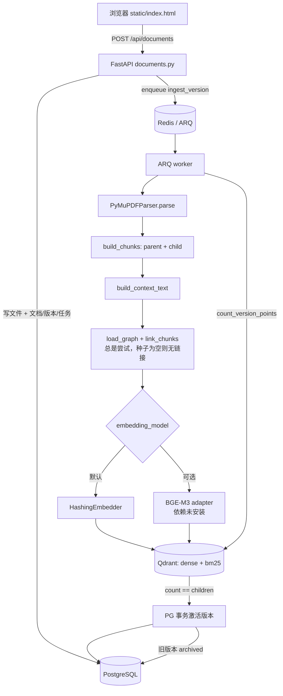
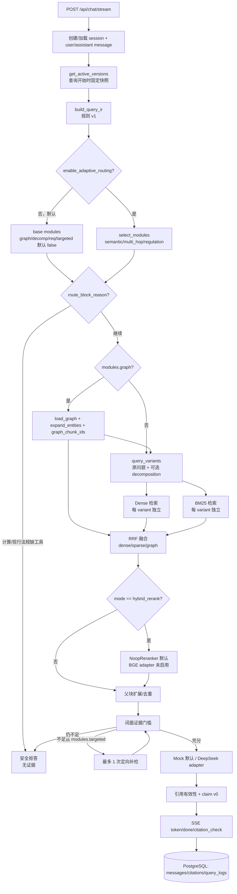

# 系统架构审计与开发方向校准（2026-10-20）

> 审计对象：当前工作区 `c3d423f` 之上的未提交改动。
> 方法：逐文件阅读实际代码 + 运行单元测试 + 查询 PostgreSQL/Qdrant 实际状态 + 复用既有冒烟/评测结果。
> 原则：只把**当前代码真实执行**的能力写成“已实现”；适配器存在但未安装、未启用、未验证的，写“部分实现”或“缺失”。

## 0. 结论摘要

当前系统已经是一个**可运行的 RAG 纵向切片**：上传 PDF、异步解析入库、版本激活、Dense/BM25 混合检索、RRF、父块扩展、证据门槛、Mock/DeepSeek 生成、SSE、引用落库、版本更新/回滚、A/B/C 冒烟测试均已跑通。它不是“架构图上的系统”，而是有真实代码和真实 PostgreSQL/Qdrant 数据的系统。

但它**还不是可用于论文实验的最终系统**，原因不是架构不够多，而是四个基础事实尚未闭合：

1. **Dense 仍是 `HashingEmbedder`**，不是 BGE-M3；当前检索质量不能代表最终系统。
2. **Reranker 仍是 `NoopReranker`**；`hybrid_rerank` 实际等价于 RRF。
3. **生成默认是 Mock**；DeepSeek 适配器未在当前环境做真实调用验证。
4. **评测集只有 5 条合成问题**，没有人工 qrels，指标没有统计意义。

因此下一阶段不应优先加 LangGraph/Agent/Elasticsearch，而应优先完成“**真实模型 + 独立索引 + 可复现评测 + 引用定位闭环**”。现有 Query IR、Graph、Requirements、Claims 等增强模块应保留为**可开关的增量能力**，用消融实验决定是否进入主线。

## 1. 模块完成度清单

状态口径：

- ✅ 已实现：有代码、有测试或实际运行证据，默认链路可用。
- 🟡 部分实现：有适配器/可选分支/原型，但未成为默认、未安装依赖或未验证。
- ❌ 缺失：当前仓库没有对应实现。

### 1.1 数据接入与索引

| 能力 | 状态 | 实际代码位置 | 证据与边界 |
|---|---|---|---|
| PDF 上传、大小/类型校验、哈希去重 | ✅ | `apps/api/app/api/documents.py` | 仅 PDF；100 MB 上限；同一内容跨文档 409；无认证 |
| 文档/版本/任务元数据 | ✅ | `apps/api/app/models.py`、`apps/api/app/migrations.py` | 13 张表；版本号按文档串行分配 |
| 异步入库任务 | ✅ | `apps/api/app/worker.py`、`apps/api/app/queue.py` | ARQ + Redis；`max_tries=3`、`job_timeout=900`；启动回收超时任务 |
| PDF 解析 | 🟡 | `apps/api/app/ingestion/parser.py` | 仅 PyMuPDF 文本型 PDF；MinerU 只有注释/占位，无适配器 |
| 页码与 bbox 规范化 | ✅ | `apps/api/app/ingestion/parser.py` | PDF points、左下原点、CropBox 相对、未旋转；落库 `location`；未用 PDF.js 反向校验 |
| 结构感知 Parent-Child 切分 | ✅ | `apps/api/app/ingestion/chunker.py` | 标题层级、表格单独成父块、child overlap；确定性 chunk id |
| Contextual Retrieval | 🟡 | `apps/api/app/ingestion/context.py`、`pipeline.py` | `enable_contextual_retrieval=False` 默认关闭；开启后索引 `context_text`；尚无重索引后的消融结果 |
| Dense 向量化 | 🟡 | `apps/api/app/ingestion/embedder.py` | 默认 `HashingEmbedder`（`hashing-dev-1024`）；`BGEM3Embedder` 适配器存在，但 `FlagEmbedding` 不在依赖中 |
| BM25 稀疏向量 | ✅ | `apps/api/app/retrieval/bm25.py` | 应用侧 jieba + 水产术语 + CRC32 索引 + BM25 权重；Qdrant `modifier=IDF`；**不是 Qdrant 原生 BM25 推理** |
| Qdrant 双向量集合 | ✅ | `apps/api/app/retrieval/vector_store.py` | `dense` 1024 Cosine + `bm25` sparse IDF；payload 索引；版本过滤 |
| 版本化激活 | ✅ | `apps/api/app/ingestion/pipeline.py`、`api/documents.py` | 先 upsert、计数校验，再 PG 事务切 `current_version_id`；旧版本归档 |
| 旧版本清理 | ❌ | 无 | 文档写了“延迟清理”，代码没有 cleanup job；归档向量/文件会长期保留 |
| 文档硬删除与文件清废 | ❌ | `api/documents.py` | 仅 soft delete；Qdrant points、chunks、原始 PDF 不删除；smoke 每次重跑都会增加 deleted 行 |

### 1.2 检索与证据

| 能力 | 状态 | 实际代码位置 | 证据与边界 |
|---|---|---|---|
| Dense / BM25 / Hybrid / Hybrid+Rerank 四种模式 | ✅ | `apps/api/app/retrieval/service.py` | 四种模式可跑；`hybrid_rerank` 的 reranker 默认 noop |
| Dense 与 BM25 并行 | ✅ | `apps/api/app/retrieval/service.py` | 每个 query variant 内 `asyncio.gather` 并行；已实测 |
| 多子查询并行 | ✅ | `apps/api/app/retrieval/service.py` | 各 variant 用 `asyncio.gather` 并行；结果按 variant 顺序融合 |
| RRF 融合 | ✅ | `apps/api/app/retrieval/rrf.py` | 支持权重；图召回可追加；无学习融合 |
| Reranker | 🟡 | `apps/api/app/retrieval/rerank.py` | `NoopReranker` 默认；`BGEReranker` 适配器存在但依赖未安装、未测延迟 |
| 父块扩展与去重 | ✅ | `apps/api/app/retrieval/service.py` | child 命中后取 parent；同 parent 只保留最高分 child |
| 品种/分类硬过滤 | ✅ | `apps/api/app/retrieval/vector_store.py`、`species.py` | doc 级 species 数组；过滤“目标品种 + 通用”；不是 chunk 级适用性 |
| Typed Query IR | ✅（规则） | `apps/api/app/query/ir.py` | 规则抽取 intent/品种/阶段/指标/疾病/年份；年份与法规目前是软标记，不做硬过滤 |
| Query IR 的 LLM/NL2IR | ❌ | 无 | 当前没有 LLM planner；不要让规则 IR 冒充 NL2IR |
| 规则问题分解 | ✅（可选） | `apps/api/app/query/decompose.py` | 多指标/并列子句拆分；只做并列 facet，不做顺序推理 |
| 真正多跳证据合并 | ❌ | 无 | 当前 multi-hop = 图一跳 + 分解 + RRF；没有“第二跳基于第一跳证据”的循环 |
| 证据要求 | 🟡 | `apps/api/app/retrieval/requirements.py` | 默认关闭；facet 覆盖检查；只做词面匹配 |
| 定向补检 | 🟡 | `apps/api/app/retrieval/service.py` | 默认关闭；最多 1 次；只对含领域词的缺口重试 |
| 证据不足门槛 | ✅ | `apps/api/app/retrieval/sufficiency.py` | 词项数/权重/覆盖率阈值；域外问题可安全拒答；规则可调、非学习模型 |
| 图扩展 | 🟡 | `apps/api/app/graph/service.py`、`seed.py` | 默认关闭；11 个实体/8 条关系，人工种子；一跳；关系 provenance 为空 |
| 图 mention 建链 | ✅ | `apps/api/app/ingestion/pipeline.py` | 入库时总是尝试建链，与图扩展开关无关；种子为空时不产生链接 |
| 自适应路由 | 🟡 | `apps/api/app/query/router.py`、`ir.py` | 默认关闭；确定性 `select_modules`；不是 LangGraph/Agent |
| 计算/法规安全分支 | 🟡 | `apps/api/app/query/ir.py`、`service.py` | `route_block_reason` 可安全拒答；没有计算工具、没有法规生效日期数据 |

### 1.3 生成、引用与展示

| 能力 | 状态 | 实际代码位置 | 证据与边界 |
|---|---|---|---|
| Mock 抽取式生成 | ✅ | `apps/api/app/generation/llm.py` | 默认；无外部依赖；用于演示/测试 |
| DeepSeek 流式生成 | 🟡 | `apps/api/app/generation/llm.py` | 适配器完整；当前 `.env` 为 `LLM_PROVIDER=mock`，未做真实 API 验证 |
| Prompt 注入防护 | ✅ | `apps/api/app/generation/llm.py` | 系统提示要求忽略 source 内指令；不是形式化安全保证 |
| SSE 流式协议 | ✅ | `apps/api/app/api/chat.py` | `meta/status/sources/token/citation_check/done/error` |
| 引用有效性校验 | ✅ | `apps/api/app/generation/citations.py` | Source ID 是否在本次证据内、事实句覆盖率；启发式 |
| 引用支持性（NLI） | 🟡 | `apps/api/app/generation/claims.py`、`support.py` | 词面重叠 v0；不是 NLI，也不是事实正确性 |
| 声明级检查 | 🟡 | `apps/api/app/generation/claims.py` | 句子级 `[S1]` 映射、支持/弱支持/未引用；标题剥离、行内引用传播；词面 v0 |
| 消息/引用/查询日志持久化 | ✅ | `apps/api/app/models.py`、`api/chat.py`、`api/sessions.py` | 引用保存版本、quote、page、bbox 快照；bbox 不发送给模型 |
| PDF 页码定位 | ✅ | `apps/api/app/static/index.html` | 引用可跳到 PDF `#page=N`；是页码定位，不是 bbox 高亮 |
| PDF.js bbox 高亮 | ❌ | 无 | 需要前端 PDF.js + 坐标 viewport 变换；验收要求仍未闭合 |
| Next.js 前端 | ❌ | `apps/api/app/static/index.html` | 当前是 FastAPI 静态单页；无 Next.js/TypeScript/Tailwind |
| 会话历史 | ✅ | `apps/api/app/api/sessions.py` | 会话/消息/引用查询；无多轮指代消解 |
| 多轮问题改写 | ❌ | 无 | 技术方案 D7 要求按需改写，当前未实现 |
| Trace 调试接口 | ✅ | `apps/api/app/api/debug.py` | 按 request_id 看排名、IR、gate、耗时、证据 |
| 认证/限流 | ❌ | 无 | CORS `*`；仅本机开发 |

### 1.4 评测、测试与运维

| 能力 | 状态 | 实际代码位置 | 证据与边界 |
|---|---|---|---|
| 单元测试 | ✅ | `apps/api/tests/` | 当前 67 passed；覆盖 IR、RRF、BM25、chunker、graph、requirements、routing、claims 等 |
| A/B/C 端到端冒烟 | ✅ | `scripts/smoke_test.py` | 上次 PASS；最新并行改动后需重跑 |
| API 批量评测 | ✅ | `scripts/evaluate.py` | 4 种模式；页面级代理指标 |
| 消融评测 | 🟡 | `scripts/evaluate_ablations.py` | 有 baseline/graph/requirements/decomposition/full_optional；5 条合成问题无区分度 |
| 人工 qrels | ❌ | `eval/sample_questions.jsonl` | 5 条合成问题；无相关性标注、无统计功效 |
| 索引一致性诊断 | ✅ | `scripts/check_index.py` | 本次新增；检查 active version 的 embedding/chunk 配置与 Qdrant 维度/点数 |
| 旧任务/旧数据清理 | ❌ | 无 | 归档不清理、软删除不清理、无 retention |
| CI | ❌ | 无 `.github` 工作流 | 测试目前靠本地执行 |
| Docker 化应用 | 🟡 | `infra/docker-compose.yml` | 只起 PostgreSQL/Qdrant/Redis；API/worker 未容器化 |
| 真实 MinerU | ❌ | 无 | PyMuPDF 是唯一可用 parser |
| Elasticsearch 后端 | ❌ | 无 | 只有 Qdrant 专用 `vector_store.py`；无统一 backend interface |
| LangGraph/Agent | ❌ | 无 | 只有确定性 `select_modules` 和一次 targeted retry |

## 2. 当前真实执行路径

### 2.1 入库路径

真实细节：

- `Contextual Retrieval` 默认关闭；开启时 `index_texts = context_text`，但引用仍展示原文 `content`。
- 图建链在 `pipeline.py` 中先于 embedding 执行，**不受 `enable_graph_expansion` 控制**；该开关只控制查询期扩展。
- 旧版本没有 cleanup；Qdrant 中会保留 archived 版本 point。审计时 52 points 中只有 12 个属于 3 个 active 文档（含 1 个 archived 版本），其余 40 个是已删除文档留下的孤儿 point；smoke 重跑后总数升到 64。
- `hybrid_rerank` 只在 `mode=hybrid_rerank` 时构建 reranker；默认 noop。

### 2.2 问答路径

真实细节：

- Dense 与 BM25 在**每个 variant 内并行**，各 variant 也并行；这是本次新增的实际能力，不是只画在图上。
- 图召回与 Dense/BM25 **没有并行**；LLM planner 不存在，所以不存在“原检索与 planner 并行”。
- `enable_query_ir=True` 默认；`enable_claim_verification=True` 默认；其余增强默认关闭。
- `route_block_reason` 只在 `enable_adaptive_routing=True` 时生效。
- `evidence` 为空时，DeepSeek 分支也会退回 Mock，不调用外部模型。
- `citation_check` 只做引用有效性和词面覆盖；不是 NLI。

## 3. 与目标架构的差距、矛盾与不必要的复杂度

### 3.1 硬差距（会影响论文主张）

1. **真实 Dense 模型缺失**  
   当前 `HashingEmbedder` 是字符/词哈希，不具备语义泛化能力。把它写成“BGE-M3 混合检索”的系统结果是不成立的。必须换 BGE-M3、独立 collection、全量重建索引，再跑同一批 qrels。

2. **真实 Reranker 缺失**  
   `BGEReranker` 只是适配器；依赖未装、未在 CPU/GPU 上测延迟。`hybrid_rerank` 当前不能作为“重排有效”的证据，只能作为“接口占位”。

3. **LLM Planner/NL2IR 缺失**  
   现在的 Query IR 是规则抽取，适合稳定基线，但不等于“LLM 理解查询”。复杂问题仍靠规则/分解；技术方案中的“按需改写”也未实现。

4. **多跳不是真多跳**  
   当前 `multi_hop` 策略只是打开图一跳和问题分解，再把多个 variant 的排名做 RRF。没有“第一跳找到实体/证据 → 第二跳基于该证据继续检索 → 证据合并”的循环。论文中只能写“多 facet 分解 + 一跳图扩展”，不能写“多跳推理”。

5. **Agent/LangGraph 缺失**  
   没有图状态机、工具调用、循环重试；只有一次定向补检和一个确定性路由函数。不要把 `select_modules` 包装成 Agent。

6. **引用支持性仍是词面 v0**  
   `claims.py` 的 `lexical_overlap_v0` 不能证明事实被来源支持，更不能证明事实正确。NLI/LLM judge + 人工抽样仍是实验阶段任务。

7. **PDF 区域高亮缺失**  
   现在只能跳到页码；验收要求的“点击引用定位原文区域”没有闭合。bbox 已在库中，但前端没有 PDF.js viewport 变换。

8. **MinerU 缺失**  
   PyMuPDF 对扫描件、双栏、复杂表格不可靠；当前 bbox 只在文本型合成 PDF 上验证。

9. **评测没有统计意义**  
   5 条合成问题、页面级代理指标、无人工 qrels；当前 hit=1.0/MRR=0.875 不能写进论文作为效果结论。

### 3.2 架构/工程矛盾

| 矛盾 | 现状 | 影响 | 处理 |
|---|---|---|---|
| 文档说“BGE-M3 Dense”，实际 hash | README 有警告，但技术栈表仍把 BGE-M3 写成固定选型 | 读者可能误以为已生效 | 在 README 顶部加“当前运行模型”状态块；实验前必须替换 |
| 文档说“MinerU 主解析器”，实际 PyMuPDF | 只有注释/占位 | 解析能力被高估 | 明确写“PyMuPDF 是唯一可用 parser”；MinerU 未实现 |
| 文档说“LangGraph 路由”，实际确定性函数 | `select_modules` 不是 LangGraph | 论文/答辩易被追问 | 保留为“确定性路由 v0”；LangGraph 放 Phase 3 |
| 文档说“旧版本延迟清理”，实际无 cleanup | 归档后向量/文件常驻 | 存储泄漏、回滚窗口无限 | 增加 retention + cleanup job；或明确“不清理” |
| 文档说“8 张表”，实际 13 张 | README 结构说明过期 | 维护误导 | 更新表数量/结构 |
| 文档说“未做问题分解”，实际已实现 | `docs/development.md` 过期 | 能力被低估 | 更新状态与开关 |
| 文档说“Qdrant BM25”，实际应用侧权重 | Qdrant 只做 sparse 存储 + IDF | 技术表述不精确 | 写“client-side BM25 weights + Qdrant IDF sparse” |
| `hybrid_rerank` 命名暗示真实重排 | 默认 noop | 实验结论可能误标 | 评测输出显式记录 `reranker=noop`；论文不写 BGE 重排 |
| 图关系“verified”但无 provenance | 8 条种子关系没有来源字段 | 不能作为领域知识证据 | 关系表加 source/review 字段；或明确“人工种子假设” |
| 删除文档只软删 | Qdrant/chunks/PDF 保留 | 数据治理/隐私风险 | 增加 purge 流程与审计 |
| active version 的 embedding 元数据在激活后才写 | `pipeline.py` 先 `_activate()` 再赋 `embedding_model` | 极短窗口内元数据为空；诊断可能误报 | 在激活前写入版本元数据，或同事务提交 |

### 3.3 不必要的复杂度（当前应降级/保留但不主线化）

- **自适应路由 + Graph + Requirements + Decomposition + Claims 同时存在**：能力多，但默认大多关闭，组合矩阵没有评测。当前不应继续叠加模块，而应固定 baseline，逐个消融。
- **图种子 + 图查询 + 图 RRF 权重**：在没有图质量评测前，`graph_rrf_weight=0.7` 只是经验值；不要用它证明图有效。
- **`hybrid_rerank` 第四种模式**：在 noop 下与 hybrid 差异只是接口路径；实验时应明确这是占位，不要消耗评测精力。
- **规则 Query IR 的字段很多**：年份、法规、计算意图目前没有对应硬约束/工具，字段存在但能力未闭环；保持 soft/unsupported，避免“字段即能力”的误读。

## 4. 技术选型风险：有证据 vs 仍实验性

### 4.1 已有运行证据

| 选型 | 证据 | 结论 |
|---|---|---|
| FastAPI + Pydantic + SQLAlchemy async | API/SSE/DB 实际运行；67 tests | 保留 |
| PostgreSQL 16 | 13 表、迁移、版本/会话/日志实际数据 | 保留 |
| Qdrant 1.12.4 + client 1.12.1 | dense+sparse 查询、payload filter、count 实际运行 | 保留 |
| Qdrant sparse + IDF | 应用侧 BM25 权重 + `modifier=IDF`；检索有结果 | 保留；但表述为 client-side BM25 |
| ARQ + Redis | 上传→worker→激活实际跑通 | 保留 |
| SSE | 前端实际收到 meta/status/sources/token/done | 保留 |
| 版本激活/回滚 | smoke 实际通过；Qdrant count 校验 | 保留 |
| bbox 规范化 | 合成 PDF 解析/落库；页码可跳转 | 保留；待 PDF.js 验证 |
| Parent-child + RRF | 单测 + 实际检索 | 保留 |

### 4.2 仍是实验性/未验证

| 选型 | 当前状态 | 风险 | 决策 |
|---|---|---|---|
| BGE-M3 | 适配器存在；依赖未装；默认 hash | 语义检索质量未知；切换后维度/索引需重建 | **P0**：独立 collection 全量重建后再评测 |
| BGE-Reranker-v2-m3 | 适配器存在；默认 noop | CPU 延迟、显存、收益未知 | **P0**：先测 20 候选的 P50/P95 与 nDCG |
| DeepSeek | 适配器存在；当前 mock | 真实 API 质量/延迟/成本/JSON 稳定性未知 | **P0**：小样本真实调用 + 失败回退 |
| MinerU | 未实现 | 扫描件/复杂版面无法处理 | P1：适配器 + 坐标校验 |
| LangGraph | 未实现 | 引入状态机但当前无复杂工具 | P2：核心闭环后再评估 |
| PDF.js | 未实现 | bbox 坐标变换/滚动定位有前端成本 | **P0/P1**：验收要求，优先于 Next.js |
| Next.js | 未实现 | 静态页可演示，但正式前端缺失 | P1：先 PDF.js 再框架迁移 |
| Elasticsearch | 未实现 | 迁移动机不足；会引入双后端维护 | **不迁移**；先抽象 backend，若要比较再做公平实验 |
| 图种子 | 11 实体/8 关系 | 覆盖极低；关系无 provenance | 保留为可选原型；不声称领域图 |
| Claim lexical v0 | 词面重叠 | 支持性误判 | P1：NLI/LLM judge + 人工抽样 |
| 5 条合成 qrels | 无人工标注 | 指标无统计意义 | **P0**：扩到 ≥50 条并标注 |

### 4.3 关于 Qdrant vs Elasticsearch 的明确结论

**现在不迁移。** 理由：

- Qdrant dense+sparse、版本过滤、count 校验已经在真实数据上工作；迁移没有性能/质量证据。
- 当前 BM25 是应用侧权重 + Qdrant IDF，不是 Qdrant 原生推理；这并不构成“必须换 ES”的理由，反而说明分词/权重逻辑已可复用。
- 若未来要做公平比较，必须固定：同一分词器、同一 qrels、同一候选数、同一 RRF 参数、同一 reranker；否则 ES/Qdrant 的差异无法归因。
- 正确顺序是：先抽出 `RetrievalBackend` 接口（`search_dense`/`search_sparse`/`count`/`delete`），Qdrant 作为第一个实现；只有在论文问题明确需要“稀疏检索后端比较”时才加 ES 适配器。**不要为了架构对称而迁移。**

## 5. 下一阶段计划（按优先级）

### P0：先让论文实验“可成立”（不做新架构）

| # | 任务 | 主要文件 | 验证 |
|---|---|---|---|
| P0-1 | 固定当前基线并提交并行检索/自适应路由改动 | `app/retrieval/service.py`、`app/query/router.py`、`app/query/ir.py`、`tests/` | `pytest -q` 67 passed；`ruff check`；A/B/C smoke |
| P0-2 | 数据隔离：只保留 3 个演示文档，清理 11 个 deleted 行/残留文件；或建立独立 eval 数据集 | `scripts/`、`data/`、`kb_documents` | `check_index.py` 输出 3 active；smoke A/B/C |
| P0-3 | 索引 manifest + 模型兼容检查：collection/embedding/dim/chunk hash 不一致时拒绝或告警 | `models.py`、`migrations.py`、`vector_store.py`、`scripts/check_index.py` | 切换配置后诊断报错；不混向量 |
| P0-4 | BGE-M3 独立 collection 全量重建 | `embedder.py`、`vector_store.py`、`scripts/reindex.py`（新增） | 同一批问题 Recall@5/MRR；记录模型快照/维度/延迟 |
| P0-5 | BGE-Reranker 真实接入与延迟测试 | `rerank.py`、`service.py`、`pyproject.toml`（optional extra） | `hybrid` vs `hybrid_rerank` 的 nDCG/MRR/P95 |
| P0-6 | DeepSeek 真实调用小样本验证 | `generation/llm.py`、`.env`（不提交） | 10–20 问；记录 token/cost/失败率；不泄露 key |
| P0-7 | 评测集扩到 ≥50 条并人工标注 | `eval/`、`scripts/evaluate.py` | 每问有 gold pages/chunks；输出置信区间/错误分析 |
| P0-8 | PDF.js bbox 高亮闭环 | `static/` 或新前端、`citations` 数据 | 点击 `[S1]` 滚动到 bbox；跨页/旋转校验 |

### P1：在稳定基线上做“可解释的增强”

| # | 任务 | 主要文件 | 验证 |
|---|---|---|---|
| P1-1 | 可选 LLM Planner/NL2IR（默认关闭；失败回退规则 IR；不覆盖硬过滤） | `app/query/planner.py`（新增）、`ir.py`、`service.py` | Mock 单测；真实 API 小样本；planner 失败时基线不回归 |
| P1-2 | Planner 与原检索并行；只对复杂/歧义问题触发 | `service.py` | TTFT/总延迟对比；简单问题不增加调用 |
| P1-3 | 真正多跳：第一跳实体/证据 → 第二跳查询构造 → 证据合并/去重 | `graph/`、`service.py`、`decompose.py` | 设计 10 条多跳问题；证明第二跳带来新证据 |
| P1-4 | 引用支持性升级：NLI/LLM judge + 人工抽样 | `claims.py`、`support.py`、eval | 支持率与人工一致率；保留词面 v0 作 baseline |
| P1-5 | `RetrievalBackend` 抽象 | `retrieval/backend.py`（新增）、`vector_store.py` | Qdrant 行为不变；单测 fake backend |
| P1-6 | 多轮指代/省略改写 | `query/`、`chat.py` | 追问集；只在需要时触发 |
| P1-7 | MinerU 适配器 + 坐标校验 | `parser.py`、`ingestion/` | 扫描件/双栏样本；bbox 可视化抽检 |
| P1-8 | 归档/删除清理与 retention | `worker.py`、`documents.py`、`vector_store.py` | 清理后回滚正确拒绝；存储下降 |

### P2：只有证据支持才做

- LangGraph/Agent 编排：当 P1-3 证明需要多步工具/循环时才引入。
- Elasticsearch 对照：当论文问题明确需要后端比较，且 P1-5 已抽象完成时。
- 图自动抽取/领域图谱：当种子图召回成为瓶颈且有标注数据时。
- 自适应路由学习化：当确定性路由的混淆矩阵证明规则不足时。

## 6. 本次审计期间已做的低风险修正

1. **Dense 与 BM25 并行**：`service.py` 每个 query variant 内 `asyncio.gather`，各 variant 也并行；保留原排序/权重/错误传播。
2. **QueryLog 路由真实化**：`chat.py` 不再固定写 `route="rag"`，写 `adaptive_route`（无则为 `rag`）。
3. **Trace 增加模块信息**：done/meta 增加 `adaptive_modules`；`_config` 增加 embedding dimension、BM25 参数、reranker model、graph weight。
4. **新增只读索引诊断**：`scripts/check_index.py`，检查 active version 的 embedding model/chunk hash 与 Qdrant 维度/点数。
5. **清理 lint 警告**并重跑测试：67 passed，ruff 通过。

## 7. 当前工作区事实（审计时）

- Git HEAD：`c3d423f feat: add rule-based query decomposition and ablation runner`
- 未提交：`app/query/ir.py`、`app/query/router.py`、`app/retrieval/service.py`、`app/api/chat.py`、`apps/api/pyproject.toml`（原有 uv 设置）、`docs/data-sources.md`（外部改动，不覆盖）、`scripts/check_index.py`（新增）
- 测试：`67 passed`；`ruff check app tests` 通过
- 实际数据：审计时 14 个 document 行（3 active / 11 deleted）、Qdrant 52 points（仅 12 个属于 active 文档的当前/归档版本，40 个为 deleted 文档孤儿）；按审计后的 smoke 重跑又新增 3 个 soft-deleted 文档，当前为 17 行（3 active / 14 deleted）、64 Qdrant points。11 graph entities / 8 relations / 112 mentions；102 query logs
- 当前模型：`hashing-dev-1024`；reranker `noop`；LLM `mock`
- 评测：5 条合成问题；上次 hybrid hit 1.0、MRR 0.875，仅用于管线自检，不是论文结论
- API/worker 仍在运行；最新并行改动后尚未重跑完整 smoke

## 8. 审计结论

**方向校准：先闭合“真实模型 + 独立索引 + 可复现评测 + PDF 定位”，再考虑 Planner/Agent/多跳。**

当前最值得保留的资产是：

- 版本化索引 + 激活顺序 + 查询快照；
- Dense/BM25/RRF/父块扩展的可运行链路；
- Query IR、Graph、Requirements、Claims 这些**默认关闭、可消融**的增强接口；
- A/B/C 冒烟与 trace 能力。

当前最需要避免的是：

- 把 hash/noop/mock 的结果写成 BGE/reranker/DeepSeek 结果；
- 把规则分解写多跳、把确定性路由写 Agent；
- 在没有 qrels 的情况下继续堆模块；
- 在没有证据的情况下迁移 Elasticsearch 或重写检索层。

下一步执行顺序应是：**提交并验证当前并行改动 → 数据/索引一致性 → BGE-M3 + reranker + DeepSeek 真实验证 → 50+ qrels → PDF.js 高亮 → 再评估 Planner/多跳。**
