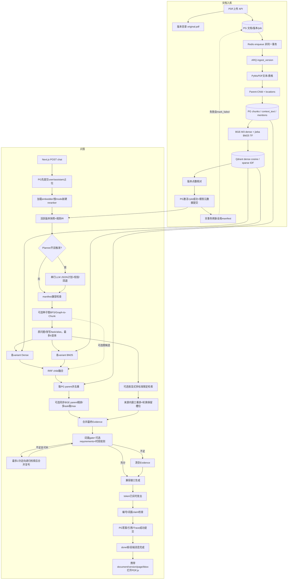
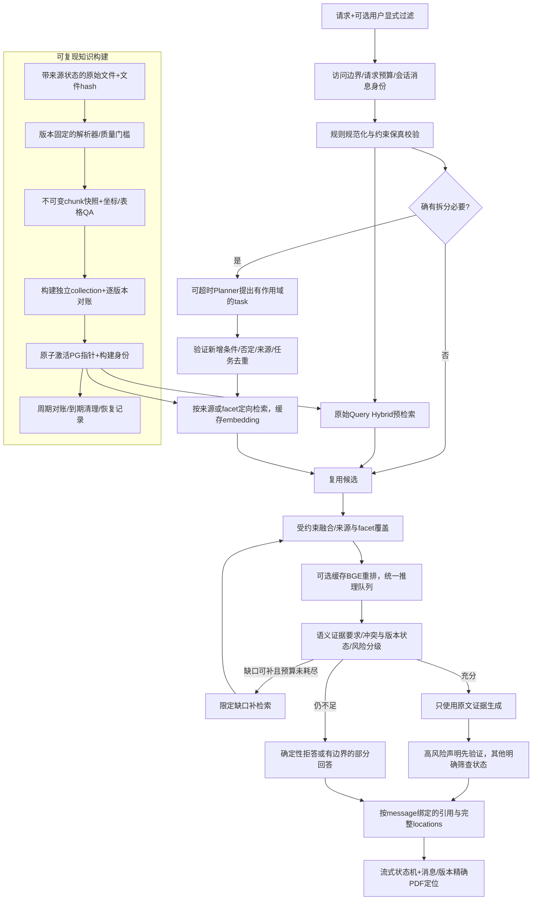

# 水产养殖 RAG 全仓库独立审计

审计基准：`main` / `8e5518370458b99b2955b3473ff11d5291349824`。实际执行日期：2026-10-21（Asia/Shanghai）；文件名按原任务保留 2026-10-20。仓库根目录：`/Users/kaicheng/coding/python/aquaculture-rag-system`。

范围调整：用户在本轮明确确认“数据板块正在完整补充，本轮继续审计，数据规模与覆盖度不作验收要求，暂不实施数据导入”。因此，本报告不把文档数量、主题覆盖或待添加数据作为验收阻塞项；已有实验的数据来源、标签、输入条件、索引一致性仍须审核，因为它们直接决定结论是否成立。

本轮仅新增本报告与 `docs/audit-evidence-2026-10-20/` 审计证据。保留原有 `README.md`、`docs/data-sources.md` 修改及未跟踪的 `docs/qa-dataset-integration.md`。没有修改应用代码、运行迁移、上传或删除文档、重建索引、修改环境配置、提交 Git，也没有新发付费 LLM 请求。

结束快照补充：审计主体完成后，工作区出现并行的数据建设改动（`apps/api/app/models.py`、`migrations.py`、`pyproject.toml`、`uv.lock`，及新增 `authority.py`、数据规划文档等）。这些不是本轮审计写入；按用户确认的范围不验收、未回退。下文代码行号以审计基准 HEAD 中的应用代码为准，164项测试、只读数据库与模型探针是各自执行时快照，不自动适用于随后新增的 schema 或数据功能。当前工作区不再只有开头三项原有改动。

状态定义：**已验证**=本轮可重复执行或原始产物独立复算；**静态确认**=由源码控制流确认，尚未做完整故障注入/浏览器复现；**历史证据**=读取既有逐题记录，未重新请求模型；**未验证**=环境或范围内没有建立证据。测试通过不等于领域正确。

## A. Executive Summary

### 总体判断

这是一个真实可运行的、具有研究原型价值的 RAG Web 系统，核心选型和主数据流没有必须推倒重建的根本性错误。FastAPI、PostgreSQL、ARQ、Qdrant Dense/Sparse、应用侧 RRF、Parent-Child 和版本化引用适合该毕业设计。**当前最大问题是验证链条不可靠，而不是技术栈不先进。**

已经验证真实 BGE-M3/MPS 输出 1024 维向量（范数 0.999811），真实 BGE Reranker 能把相关文本排到无关文本之前；当前集合有 190 个点，其中当前版本可见点187个、非当前版本点3个；6 个活跃文档的当前版本 child 点数均与数据库一致。服务健康接口返回三个依赖均正常。前端 TypeScript 检查和生产构建成功，真实 PDF 阅读器只读 E2E 4/5 通过。

但当前还不能将“测试全通过”“manifest 正常”“子问题合格率 0.8”“引用有效”“图关系 verified”写成充分正确性证据：

1. **两份 nDCG 实现都把不相关项删掉后再折损排名，既有 nDCG 数字系统性高估。**
2. **相同原始 PDF、相同配置 hash、相同 PyMuPDF 版本，用当前代码重新解析，chunk 数量与 ID 大范围不同。**当前索引和当前解析代码不是同一可复现构建，现有检查仍返回 `ok=true`。
3. **评测额外输入了标签中的品种和分类。**57/70 题的品种硬过滤因此改变；不能把这些成绩当成默认网页纯问题输入的质量。
4. **历史消息点击引用可能显示最新回答的同号来源**；阅读器侧栏还会把另一版本的 bbox 用到当前 PDF。
5. **词面 gate 和引用支持检查无法处理否定、完整性、适用条件。**R064 原题已被时效规则拦截，但去掉“最新/年份”的禁药完整清单问题实际仍放行。
6. 检索失败的错误记录路径二次抛错；上游流正常 EOF 但缺少完成标记也会当成功。
7. 非零 CropBox 的实际解析反例会丢正文；跨页 quote 总是配第一页位置。
8. 10/10 图关系是无文献 provenance 的 verified 种子边，尚无独立检索增益证据。
9. Planner 整体当前不优于规则基线，但“仅退化两题、没有改善”和“0.8 子问题覆盖合格”都超出了实际指标含义。
10. 认证、权限、请求限流与公网部署边界未闭合；目前只能按受控单用户本地演示评价。

### 分维度评价

| 维度 | 判断 | 依据与限制 |
|---|---|---|
| 架构 | 合理，可继续建设 | 主干完整；增强功能应逐项消融，不需要为 Agent 名义增加组件 |
| 实际功能 | 本地可演示，异常路径未闭合 | 健康/模型/真实阅读器可验证；本轮未新做真实上传写库 E2E |
| 检索质量 | 有正面工程信号，尚非正式学术结论 | Recall/MRR 可复算；nDCG 要重算；有侧输入和测试集调优 |
| 证据可靠性 | 尚未达到高风险问答要求 | 词面规则、来源状态缺失、多轮来源错配等 |
| 前端 | 已有完整产品骨架，需正确性修复 | 构建通过、阅读器 4/5；跨消息/跨版本绑定有缺口 |
| 工程质量 | 有良好基础，恢复与可复现性不足 | 164 单测通过；lint 5 项失败；manifest 并非构建证明 |
| 论文准备 | 方法/实现章节可写；效果结论需更正与重新设计验证 | 现有结果应定位为探索性实验 |

## B. 按优先级的问题清单

工作量为单人有效开发时间粗估，不含数据人工审核、等待模型或部署采购。P0 表示涉及错误结论或部署安全阻塞，并不表示已经发生生产事故。

### F01 / P0：nDCG 计算丢失真实排名，影响全部相关实验

- **位置**：`apps/api/app/evaluation/retrieval_metrics.py:43`；重复实现 `scripts/evaluate_retrieval_metrics.py:102`。
- **根因**：`[gold[id] for id in ranked[:k] if id in gold]` 删除不相关项，DCG 将剩余相关项重新从第一名计。正确做法应保留 `gold.get(id, 0)`，在原位置折损。
- **复现/证据**：运行 `counterexamples.py`，排名 `['wrong','correct']`、单一 grade=2 gold，两个实现均给 nDCG=1；正确值为 `1/log2(3)=0.630930`。现有 `test_retrieval_metrics.py:9` 同时改变相关项顺序与位置，无法识别这种错误。
- **影响**：历史 parent/child nDCG、Planner A/B 和 Contextual 表格的 nDCG 均须更正；Recall 和 MRR 不因此失效。独立重算详见 E。
- **建议**：统一唯一 scorer，加入“插入一个不相关项必须降低 DCG”、单一 gold、不同 grade、重复 ID、零 grade 的独立公式测试；保留原结果为历史，不覆盖。
- **成本/验收**：0.5 天；已保存排名直接重算，无需新调用 LLM。以独立计算器逐题比对。

### F02 / P0：高风险问题 gate 只判断词项相关性，支持检查可把反义句判为 supported

- **位置**：`retrieval/sufficiency.py:178` 的 `assess_evidence`；`retrieval/service.py:1075`；`query/ir.py:274`；`generation/support.py:33`；`generation/semantic_claims.py:78`。
- **已验证**：真实本地检索 `2026年最新禁用渔药名单里具体有哪些品种？` 返回 `current_regulation_unverified`；同类问题 `水产养殖禁用渔药完整清单有哪些？` 返回 `matched` 和 5 份证据。
- **反例**：引用“溶解氧宜保持在5 mg/L以上”，声明改为“不宜保持”，词面验证仍给 `supported`、0.857。证据明确写“未列出完整清单”的离线反例也会以 coverage=1 放行。
- **根因/影响**：时效保护依赖年份/“最新、现行、有效、废止”等措辞；没有完整清单、冲突、适用阶段、版本法规状态的实质判断。可选 cosine 甚至将相似文本升级为 `supported`；方法标签诚实不等于结果名称安全。后验校验在流出答案后执行，也不阻止错误内容展示。
- **建议**：先加入高风险意图、来源等级/版本状态/适用范围、清单完整性要求；无可靠材料时返回确定性缺口说明。将启发式支持结果命名为词面/相似性筛查。语义支持与事实正确率用独立人工审核或经校准蕴含验证评估。
- **成本/验收**：1–3 天最小保护；否定、单位、主体、日期、完整性和冲突最小对照组必须分别检验。当前放行不证明本轮真实 LLM 已生成错误药单：本轮没有发该生成请求。

### F03 / P0（对不可信网络部署）：业务接口无认证、无所有权隔离，CORS 全开放

- **位置**：`app/main.py:50`；`api/sessions.py:45,56,201`；`api/documents.py:86,520`；`api/debug.py:18`；`infra/docker-compose.yml:9,25,40` 的端口发布。
- **静态确认**：`ChatSession.user_id` 只是字段，查询和写入不检查身份；可列出会话、读取引用/Trace、删除文档；CORS `*`，允许所有方法。Compose 端口未约束到 loopback，Qdrant/Redis 未配置访问认证。
- **风险边界**：这不等于确认服务已暴露公网或发生泄漏；本轮只通过 loopback 访问。文档所谓“local-only”不是代码访问限制。
- **建议/成本**：保持受控本地演示；共享访问前统一身份、资源所有权、可信 origin、请求速率/并发限制，并约束依赖端口。1–3 天最小方案；用两个身份做读取、删除、Trace 越权测试。
- **已做安全核查**：扫描 698 个可达 Git blob，匹配当前配置密钥及常见凭据模式，未发现命中。不覆盖不可达 Git 对象、外部日志、历史聊天或其他旧密钥。

### F04 / P1：聊天引用缺少 message 命名空间，老回答会选中新回答的来源

- **位置**：`apps/web/src/components/chat/chat-workspace.tsx:54,74,158,185`；`message-list.tsx:105,250`；`citation-chip.tsx:26`。
- **静态确认**：右侧 `activeSources` 永远取最后一个有来源的回答；所有消息的点击回调只传 `index`，未传 message ID。两条回答都可有 S1，点击第一条的 S1 仍只选中最新来源数组里的 1。
- **影响**：Source ID 在回答内部合法，但跨消息映射可错误；用户随后打开的是另一文档或版本。这直接破坏核心“回答→来源→原文”承诺。
- **复现步骤**：同一会话先问蟹标准、再问虾标准，使两条回答 S1 不同，点击前一回答 S1，检查面板和 PDF 的 version_id。无需假数据。
- **本轮边界**：只读扫描现有 API 会话未找到满足“两条回答且首来源不同”的适合样本，因此未冒充完成此浏览器场景；控制流已经确认。
- **建议/成本**：用 `(messageId, sourceIndex)` 选择来源，让面板取被选中消息；0.5–1 天，补真实多回答 E2E。

### F05 / P1：当前解析器与实际索引不对应，hash 与检查器未发现构建漂移

- **位置**：`ingestion/pipeline.py:30,37`；`retrieval/index_manifest.py:21`；`scripts/check_index.py:97`。
- **本轮只读实证**：从版本记录的原文件重新 parse/build_chunks，文件 SHA 与版本元数据一致，PyMuPDF 均 1.28.2，chunk hash 均 `4868e31c…`，但结果如下。

| 标准 | 库中 parent/child | 当前代码重解析 parent/child | 新旧共享 ID / 库中总 chunk |
|---|---:|---:|---:|
| DB36 | 30 / 34 | 29 / 32 | 2 / 64 |
| DB46 | 88 / 109 | 94 / 113 | 40 / 197 |
| DB32 | 32 / 35 | 31 / 33 | 19 / 67 |

- **术语粘连的关键区别**：库中 DB46 `060eb863…` 仍合并术语与“4养殖环境/5养殖设施”；当前解析代码已识别页 7 的“4养殖环境”为 heading=2，重新切块产生独立环境 parent `0b351996…`。因此不能简单说“当前 heading 修复未实现”；实际是**修复未反映到正在查询的 chunks**。
- **根因**：hash 只含少量数值参数、model/contextual 和固定 `PIPELINE_VERSION='v1'`，不含 parser/chunker 实现指纹、代码 revision、context 版本、模型快照、embedding max_length。新增/修改切分规则不会自动改变该 hash。
- **检查漏洞**：`check_index.py` 本轮仍输出 `ok=true`；它对有合法 manifest 的版本 hash 差异放行，且未逐点核对 DB 内容、计算配置、parser 输出。全局点数相等不是构建一致证明。
- **建议/成本**：冻结原始 PDF、chunk 产物和实现/依赖/模型版本，构建独立候选索引并做 golden diff，再人工迁移 qrels；**不要直接在当前版本上重跑 ingestion**，否则旧 UUID/qrels/历史引用关系会改变。1–2 天工具与隔离验证，标注迁移另计。

### F06 / P1：检索失败路径会再次抛 AttributeError，失败状态无法提交

- **位置**：`api/chat.py:118–142` 调 `_persist_failure` 未传 retrieval；`api/chat.py:452` 无条件访问 `retrieval.config`。
- **已验证**：隔离 FakeDB 调原函数，得到 `AttributeError: 'NoneType' object has no attribute 'config'`，`committed=false`。没有操作真实数据库。
- **影响**：原本希望返回 503 的检索错误可能变成 500，已提交的 assistant 占位仍是 `streaming`。模型初始化发生在 try 外（`chat.py:88–108`），同样缺少统一状态收尾。
- **建议/成本**：保护 None；对模型初始化、检索、生成、校验、持久化设置完整状态边界及 finally 收尾；0.5 天。断开 Qdrant、缺模型、缺 key 等故障在隔离环境注入，检查 API 状态和消息终态。

### F07 / P1：上游 LLM 缺失完成标记仍按成功持久化

- **位置**：`generation/llm.py:274–296`；`api/chat.py:229,251,287`。
- **已验证**：使用真实生成客户端实现和本地 HTTP MockTransport，仅给一帧 `partial` 后正常 EOF，没有 `[DONE]` 或 finish_reason，函数正常返回，没有异常。该反例用于验证协议处理，不用于证明真实模型问答可用。
- **根因**：忽略 finish_reason、不检查流终止；跳过 JSON 错帧；只要答案非空，后端就可继续完成 citation_check 并存 completed。`length` 截断、上游 error 帧也未分类。
- **建议/成本**：完成条件显式建模，区分 stop/length/content_filter/error/缺终止；保留 partial 并告警。0.5–1 天，用可控流测试正常结束、断流、超时、JSON 损坏和失败帧。

### F08 / P1：评测使用标签侧信息，不能代表默认纯问题输入

- **位置**：`scripts/evaluate_retrieval_metrics.py:226–239`；`scripts/evaluate_planner_retrieval.py:85–89`；`query/ir.py:197`；默认网页 `apps/web/src/app/chat/page.tsx:13`。
- **已验证**：70 题中 66 题传 species、67 题传 category；独立构造 IR 时，**57 题**从 query-only 的无 species_filter 变成标签指定的硬过滤。例 R003“环沟塘的沟宽和沟深有什么要求？”被直接传入中华绒螯蟹。
- **判断**：如果用户确实在 UI 选择该品种/分类，这是合法受控实验；如果将该成绩宣传为“系统只读用户原问题自行理解”，则是标签侧信息进入推理输入、存在答案侧路由泄漏风险。没有证据称所有数据均存在恶意泄漏，也不能说运行服务读取了 gold。
- **建议/成本**：明确两组设置：query-only 主评测、用户指定过滤的条件评测；IR/NL2IR 与检索质量分开。0.5 天脚本规范及标注输入审计，重跑成本另计。

### F09 / P1：图谱 verified 与文献可追溯性不一致，尚无证据级多跳

- **位置**：`scripts/seed_graph.py:57–83`；`graph/service.py:77,151,199`；`retrieval/service.py:451–467`。
- **实证**：DB 10 条关系，10 条 verified，10 条 `provenance_document_version_id=None`；种子脚本直接写 confidence=1.0、verified，未见 reviewer/审核记录。
- **影响**：relation_trace 有字段但全空，不能回答“这条边是哪份原文支持的”。source.graph_provenance 只有实体、路径、次数、seed_terms，并没有边来源字段；可解释检索路径不等于可追溯领域事实。
- **多跳判断**：BFS 两跳已实现；图扩展发生在主检索之前。没有读取第一跳证据后提取新条件、再执行依赖证据的第二跳检索。targeted 是预定义 facet 缺口补检，也不等同于推理链。
- **建议/成本**：人工种子标明 curated_unverified 或明确审核人/日期；边以文档版本+页码+句段支持，禁止将路径当因果结论。保持默认关闭；0.5–2 天治理字段，收益实验另计。

### F10 / P1：激活后的 manifest 失败可留下 current 指向 failed 版本；manifest 可被新配置覆盖

- **位置**：`ingestion/pipeline.py:206–233,242–271,311–325`；`retrieval/service.py:346–360`。
- **静态确认**：版本激活、job succeeded、embedding 元数据在 222 行同一提交；随后 `_refresh_manifest` 才执行。若该步骤失败，except 将版本标 failed，但不回退 document.current_version_id。查询活跃版本只检查文档状态/current 指针，未检查版本 ready。
- **另一风险**：每次单文档 ingestion 刷 manifest 时，把当前配置的 model/chunk/BM25 hash 写给整个 collection，未验证其他既有点是否按同配置构建。检索又优先信全局 manifest，可能掩盖配置混建。当前混建事故**未验证**，这是可执行控制流风险。
- **纠正旧报告**：`_activate()` 末尾是 flush，不是 commit；embedding metadata 与激活当前实际上一起提交，不应继续引用“激活后到 embedding metadata 提交有短暂窗口”的旧问题。真正未原子化的是随后 manifest 的失败处理。
- **建议/成本**：不可变构建 manifest + 每版本/collection 构建状态；将 derived metadata 刷新失败与 ingestion 内容失败分离；失败不损坏已成功激活状态。1–2 天，在临时库注入 manifest 写失败、新旧配置混建、重试乱序与删除竞争。

### F11 / P1：非零 CropBox 被重复扣偏移，能直接丢失正文

- **位置**：`ingestion/parser.py:140–145,206–212`；现有测试 `tests/test_coordinates.py:15`。
- **已验证**：内存 PDF，MediaBox 600×800、CropBox (100,100,500,700)，原点 (150,200) 插入普通文字。PyMuPDF `get_text` 返回 crop-relative rect (50,87.10,180.68,103.59)，parser 将它与带偏移的 crop rect 比较，输出为空。
- **根因**：真实 API 的文本坐标已经相对 CropBox；测试却人为输入未平移坐标再验证减法，证明了错误假设。即使没过滤掉，`_canonical_bbox` 再减 crop.x0/用 crop.y1 也会错位。
- **建议/成本**：以真实 PDF API roundtrip 定义坐标，建立 0/90/180/270 度、非零 MediaBox/CropBox、不同缩放的测试矩阵；0.5–1.5 天。当前标准普通页面的高亮 E2E 通过，不覆盖此反例。

### F12 / P1：跨页引用与阅读器版本选择不完整

- **位置**：`ingestion/chunker.py:38,271`；`retrieval/service.py:897,907`；`reader/reader-client.tsx:54`；`reader/reader-workspace.tsx:154`。
- **静态确认**：child 复制 parent 全部 locations；parent 跨页时，quote 可能取后页句子，但 Evidence 只取 `locations[0]` 和 `page_from`。位置是整父块包围框，也不是 quote 的逐句坐标。
- **版本问题**：`/documents/{id}/citations` 返回该文档所有版本引用；ReaderClient 不按当前 versionId 过滤；点击侧栏只改 page/bbox，不切换引用的 document_version_id。因此旧版本位置可高亮新版本正文。左侧页数也来自当前文档列表，不一定是正在阅读的历史版本页数。
- **删除问题**：引用快照保留，但 `/documents/{id}/file` 在 deleted 时无条件 404；7 天“保留文件”不等于历史引用仍可访问，也没有 restore API。
- **建议/成本**：quote 与块/页面片段绑定、返回全部 locations；侧栏按版本过滤或点击原子切换版本；定义历史访问权限。1–2 天，验证跨页后半句、两版排版变化和删除后历史引用。

### F13 / P1：Planner 探针的“0.8 合格率”只计子问题数量，比较结论被夸大

- **位置**：`scripts/evaluate_planner.py:48–66`；`docs/planner-ab-70q-2026-10-20.md:9`。
- **源码事实**：`subquestions = float(len(ir.planner_subquestions) >= expected['subquestions_min'])`。没有检查语义覆盖、相关性、重复、顺序依赖或是否保留原条件。
- **影响**：0→0.8 只表示“达到指定数量的比例”；规则侧该字段本来为空，也未调用规则 decomposition，不能推导“LLM 子问题语义合格率提高到80%”。`field_accuracy` 是实体字段集合 F1 与 intent 命中值的宏平均，不是逐字段 exact accuracy；报告称人工标注，但产物明确是 author engineering probes，独立人工复核**未验证**。
- **建议/成本**：修改论文指标命名；在相同可用 decomposition 基线上盲评每个 task 的完整/必要/正确约束/新增假设，分母含 fallback。0.5 天改评测，人工审核另计。

### F14 / P2：重排每请求重新加载，且同步阻塞 async 事件循环

- **位置**：`api/chat.py:98–108`；`retrieval/rerank.py:40–66,71`；`retrieval/service.py:769–795,829–837`。
- **静态确认**：embedder 有 lru_cache，reranker 构造无缓存；每个 hybrid_rerank 请求新建 FlagReranker。主检索在 async 函数内直接同步 `.rerank()`；MPS flock 等待和推理都可能卡住事件循环。可选 semantic claims 也同步计算。
- **不是逐条推理**：当前每个 rerank query 对所有 parent 构造 pairs，一次 `compute_score`；本机依赖默认 batch_size=128、max_length=512（库源码核查）。不能把“compute_score 串行调用”说成“每个 Chunk 单条请求”。
- **重复**：Planner 最多原问题+3个 task，同一候选池跑最多4次，取每 parent 最大分；source anchors 另跑各来源窗口重排。候选先按 parent 去重，避免了 variant 对同一 child 的单独全流程重排，但 task 间仍重复计算。
- **建议/成本**：进程缓存实例、集中推理执行器或 to_thread、控制并发与deadline；为覆盖多个 facet 设计覆盖约束而非只取最大分。0.5–2 天；用两个并发请求和健康接口心跳验证阻塞与内存，不只看吞吐均值。

### F15 / P2：Planner 软约束仍会影响查询，Schema 不能确保语义保真

- **位置**：`query/planner.py:222–267,351–385`；`retrieval/service.py:479–509`。
- **优点**：明确实体校验，规则 hard filter 优先；未知/推断品种不会自动成为硬过滤，非实现字段降为 soft。
- **缺口**：子问题增加未确认品种只 warning，仍入检索；rewritten_query 自由文本直接采用。intent 由模型覆盖而 strategy/current_regulation 沿用规则，可能不一致。没有显式观察/假设/诊断/事实的类型；“不是某品种”仍有词面命中硬过滤风险，跨物种 task 不具独立过滤。
- **建议/成本**：保持规则安全边界，增加否定/范围/每任务作用域验证；坏计划回退，推断只作为可审计补充通道；1–2 天。R066 的无效额外 task 需要用留出集验证修正，不在同题上反复调到正确。

### F16 / P2：7 天 retention 有计算规则但无到期调度，且不是物理数据清理

- **位置**：`api/documents.py:567–573`；`worker.py:116–126`；`maintenance/cleanup.py:96–142`。
- **静态确认**：删除时马上 enqueue cleanup，此时尚未到7天会保留；worker 没有 cron_jobs，也没有延迟7天入队。没有后续删除或人工 CLI 时，到期不自动触发。清理只针对当前配置的一个 collection 的 deleted 文档点；其他 collection、archived 活跃文档版本、DB/PDF 不清理。
- **建议/成本**：定期 dry-run/清理、跨集合构建登记和有界保留政策；明确“向量保留期”与“文件/行保留期”，0.5–1 天。时钟推进测试和真实隔离队列验证到期执行。

### F17 / P2：Token、成本、耗时统计不完整

- **位置**：`generation/llm.py:259,284–289`；`api/chat.py:111–116,271–282,314`；`debug/stats-strip.tsx:112`。
- **静态确认**：流式请求未显式请求 usage；网关是否返回 usage 不保证；同一 generator 先 Planner 后生成，`last_usage` 被覆盖，若生成流没 usage 还可能保留 Planner 的数，成功 usage 则只剩生成用量。重试、失败尝试不累加。
- **当前配置**：价格两项均0，前端统计展示 `$0.0000`，含义应是未配置价格，不是免费。generation_ms 从首 token 起算，遗漏等待首 token 的生成时间；dense_ms/sparse_ms 是变体耗时相加（含排队），不能与检索墙钟相加理解为阶段拆账。
- **建议/成本**：per-call ledger、usage 来源和缺失标记、unknown cost=null；单独记录队列/模型/网络/首字/完整生成/持久化。0.5–1 天，构造 Planner+生成+重试有无 usage 的组合测试。

### F18 / P2：Contextual 不是严格单变量实验，当前 ctx 集合配置也不兼容

- **证据**：raw QIR manifest 为 `acabfc1` dirty，ctx QIR 为 `b6c4ac6` dirty；旧 BM25 本应相同，却 R@5 从0.8507变0.8657。没有冻结代码工作区差异、每点 sparse/IDF统计、完整运行配置。
- **本轮补核**：当前 raw/ctx 两集合 point ID 集合相同，190/190 sparse 向量及 payload content_hash 均一致；这只能证明现在一致，不能反证历史运行没有漂移。ctx manifest 的 bm25 hash 仍为空，当前检查逻辑会阻止以当前 BM25 hash 查询 ctx 集合。
- **建议/成本**：新建隔离候选、同一代码/依赖/数据/模型和 sparse快照，两组只改 dense输入；0.5–1 天实验准备，运行另计。旧 Recall 改善可作为探索线索，不能直接声称全部为 contextual 因果增益。

### F19 / P2：去重、回滚与任务并发一致性仍有缺口

- **位置**：`api/documents.py:117–131,248–274,356–362,630–632`；`ingestion/pipeline.py:75,83,130,188`；`worker.py:20–25`。
- **静态确认**：内容重复先查后写、无 hash 唯一约束；同文档新增版本查重发生在行锁之前，并发相同文件仍可生成两版。回滚仅检查点数非0，不核对完整 child数量/配置。retry_job 改 queued 后才检查队列，pool=None 时可能留下 processing/queued。
- **并发风险**：max_jobs=1 仅约束单 worker；没有每版本分布式租约，不同 job ID/进程可同时删除重建同一版本。取到的 doc ORM 状态可能早于并发删除，激活处行锁检查也需验证 refresh/identity-map行为。MPS flock 仅串行推理，不锁模型加载和内存占用。
- **建议/成本**：内容幂等键与版本租约、回滚完整性校验、DB outbox/队列补偿、避免从 failed metadata 覆盖 ready；1–3 天。事故与并发发生率本轮未验证，不推断真实数据已损坏。

### F20 / P2：部署与测试口径尚不具可移植验收证据

- **位置**：`apps/web/package.json:7–9`、`next.config.ts:11`；`Makefile:4`；`.env.example:76–85`；`infra/docker-compose.yml`。
- build 设置 `NEXT_DIST_DIR=.next-build`，start 未设置，会按 `.next` 查找；在只做 build 的干净目录中启动路径不匹配。README/Makefile 的普通 `uv sync` 没安装 bge extra，但默认 embedding 已是 BGE。`.env.example` targeted=false、variants=4、targeted cap=1，和代码/本机分别 true/6/2 不一致。
- 依赖并非完全没锁：`uv.lock`、`package-lock.json` 均跟踪；但模型权重、PDF、eval/runs 被忽略，缺独立的可分发复现包。Compose 只含依赖服务，没有 API/worker/Web 完整部署。没有 `.github` CI。
- lint 本轮5项错误，和前报告“ruff clean”不一致：compare_modes 2项，answer_quality EXE001，planner_retrieval RUF100，reindex I001。
- 现有 E2E 多项会上传、删除、改版本，且 helper/部分测试硬编码8000。**不能将它们直接对真实知识库全量运行或假设换 API 环境变量已经隔离。**
- 建议/成本：统一 build/start 与样例配置，锁定 extra、模型revision，准备独立测试环境，CI跑纯测试和契约，1–2 天。

### F21 / P2–P3：前端恢复、Trace、可访问性仍需收尾

- **位置**：`hooks/use-chat.ts:56–103,222–249`；`reader/pdf-viewer.tsx:136–148,218–242`；`debug/debug-workspace.tsx:181–215`；`chat/source-card.tsx:29`。
- 历史消息未恢复 requestId/gate/sufficient 等信息，无法等价重现实时 UI；切会话没有取消/隔离旧请求回调，可能把旧会话状态写入新会话。新建会话/重试存在异步收尾竞争，需要实际并发 E2E。
- RerankDelta 对比 child fused 与代表 child 的最终结果，但中间还包括父块合并、来源保留槽位、截断/gate；这不是纯 reranker 的因果排序变化，Trace缺完整每阶段分数与候选映射。
- 阅读器本轮页码跳转测试失败：偏移126.15625px，断言应<120；截图确认第8页已到可见区，只能报滚动对齐/测试稳定性问题，不能说翻页完全失败。缩放下未显式cancel旧renderTask，版本切换状态需专项验证。
- SourceCard 的article点击没有键盘role/tabIndex；可访问性应有键盘导航/焦点测试，当前未跑完整a11y审查。
- 建议/成本：0.5–2 天；保护会话请求代次、持久化必要元数据、阶段Trace、键盘与移动端真实功能回归。

## C. 当前真实架构与执行链路

### 当前运行配置与代码版本

本轮 `/api/health` 报：`kb_chunks_bge_m3_v1`、BGE-M3、mps、BGE-Reranker、openai_compatible；本机按 `apps/api` cwd 加载 Settings：模型名 `deepseek-v4.1-flash-1017`、两本地模型 fp16=true、max_length=1024、max_sources=5、index_manifest_required=true。

**配置证明边界**：运行服务的健康接口没有 build SHA 和生成模型完整名；无法凭健康接口证明已启动进程与磁盘 HEAD、全部环境值完全相同。本轮进程内检索与静态审计明确使用当前 HEAD。既有文档中的 `openai-compatible-model` 是泛化/脱敏描述，不是可用的模型快照标识。

| 模块 | 代码默认 | 本机 Settings | 真请求行为 |
|---|---|---|---|
| Query IR | true | true | 规则解析 |
| LLM Planner | false | false | 默认不调用 |
| Dense/BM25 | hybrid | hybrid | 默认双路 |
| Reranker | 适配器BGE | BGE | 仅 mode=hybrid_rerank；默认hybrid不调用 |
| Source-aware | true | true | ≥2个可解析且能解析到活跃标题的标准触发 |
| Requirements | false | false | 默认不做facet齐全检查 |
| Targeted | true | true | gate不足且可补缺口才运行，最多2次 |
| Graph/Decomposition/Adaptive | false | false | 默认不运行 |
| Contextual | false | false | 当前raw collection |
| Claim verification | true | true | 词面筛查 |
| Semantic claims | false | false | 默认无额外embedding |
| 生成 | mock | openai_compatible | 本轮未新请求；历史产物有真实回答 |

### 当前代码架构图

**图的解释**：Dense/Sparse、variant以及anchor查询通过 gather并发；MPS实际编码由锁串行化，不等于GPU并行吞吐。Planner 在任何 Dense检索前 await，**没有与原问题预检索并行**。graph也先串行计算。reranker直接同步运行；来源窗口精排接在全局精排之后。

### 入库逐步数据/事务/失败路径

| 阶段 | 类/函数与输入输出 | 同步/异步及一致性 |
|---|---|---|
| 上传 | `upload_document`：UploadFile→bytearray→SHA256→UUID版文件 | 100MB、PDF扩展/MIME/魔数；先写文件后验证部分元数据，可留孤儿文件；未沙箱解析/限制页数与展开内存 |
| 元数据 | KbDocument/KbDocumentVersion/KbIngestJob | PG commit后才enqueue，无outbox；队列不可用时持久化failed job，version可能仍processing |
| 解析 | `PyMuPDFParser.parse`→ParsedDocument/ParsedBlock | `to_thread`；没有OCR，MinerU仅NotImplemented；表格失败可回退普通文本且没有专门质量告警 |
| 切分 | `build_chunks`→ChunkDraft(parent/child) | 同步；900/350/60字符目标，非严格token上限；表格按行带表头，不具表格语义/合并单元格验证 |
| 写块/上下文/图mention | context由标题/章节/品种拼接→PG chunks，`link_chunks` | context不调用LLM；图mention不受query图开关控制；数次独立commit，失败可能保留中间态 |
| 编码 | `get_embedder` / `BM25SparseEncoder` | Dense to_thread；context开时只改Dense文本，Sparse保留raw；图没有实体关系自动抽取 |
| 向量写入 | 删除该version旧点→zip(strict)→64点批upsert→count | 点数相等只证明数量，不证明每个向量有限/非零/文本hash一致；失败无跨库原子回滚 |
| 激活 | `_activate`行锁、版本号防旧任务覆盖→flush→统一commit | 正向设计合理；后续manifest失败处理见F10；重试可能先删/重写chunks和向量 |
| 删除/归档/回滚 | current_version_id过滤、soft delete、retention、回滚 | 查询可见由PG指针决定；归档点保留；回滚只查非0；清理与历史访问缺口见F12/F16/F19 |

上传filename不直接拼接到路径，UUID目录降低普通路径遍历风险。PDF头检查不是恶意PDF防护；运行在thread而非独立资源沙箱，本轮未做恶意文件压力测试。

### 问答数据、调用次数与耗时边界

1. ChatRequest(question/session/category/species/mode)→先提交user和空assistant。
2. 创建/获取模型→读当前版本与品种选项→规则 QueryIR；可选 PlannerIR经 Pydantic和合并校验回到 QueryIR。
3. 读manifest→确定类别/品种硬过滤→可选图→构建查询变体→每路 SearchHit(chunk_id,score,payload)。同一文本在不同anchor仍重复embedding，只有variant列表做字符串去重，没有请求级embedding缓存。
4. RRF融合→PG查child/parent/version/document→按parent最高分child代表→可选精排→来源保留→Evidence(版本、parent/child、quote/content、单location)。
5. 词面/requirements/时效gate→可选targeted重新取活跃快照、再检索并合并。递归没有冻结传入首轮active_versions，期间更新可混用版本，需隔离并发测试。
6. evidence不足默认清空；兼容接口分支仍构造真实generator并调用stream(question,[])，不是本地确定性拒答。原生deepseek无证据可切Mock；服务提供者间行为不同。
7. HTTP StreamingResponse在检索结束后才建立；meta/status/sources先发，随后token*。没有检索期间SSE心跳。生成后才做引用/claims，再保存，再done。
8. 用户历史未送到模型；session只负责持久化，**不具多轮指代消解**。

| 场景 | 外部LLM请求次数 | 备注 |
|---|---:|---|
| 当前默认兼容接口 | 1次生成 | 无证据也可调用；本轮没有新发 |
| Planner触发且正常 | 1次规划+1次生成 | JSON解析/empty可重试规划一次，合计最多3次 |
| Planner跳过/不可用 | 0次成功规划+1次生成 | 失败尝试仍有时间/潜在token成本 |
| Targeted补检 | 额外0次LLM | `_attempt>0`跳过Planner；重复检索、embedding、可能rerank |
| semantic claims开启 | 额外0次LLM | 多一次embedding批，当前关闭 |

本轮五题真实本地检索墙钟（进程已载入模型，不含生成、HTTP与模型冷启动）：R061 2311.7ms；R062 1627.6ms；R064 1572.0ms；R066 1421.3ms；无日期药单1512.6ms。这是诊断样本，**不是P50/P95或新系统性能基准**。dense_ms为变体计时和，不能与墙钟直接相加。历史三题 5.93s/13.98s 包含真实生成与前置处理，不能与这些检索耗时直接比较。

### 合理目标架构图（建议，尚未实施）

该目标不要求LangGraph、不要求Planner默认开启。Graph仅在有来源、经过审核、能贡献独立新证据后才作为可选检索通道接入。先实现验证边界，再决定编排框架。

## D. 模块审计矩阵

| 模块 | 实际实现/默认启用 | 本轮证据与测试覆盖 | 正确性风险/建议 |
|---|---|---|---|
| 上传/任务 | 文件+PG+ARQ；启用 | 源码/契约；现有单测不是真实写库E2E | outbox、资源限制、重复请求 |
| 版本激活 | PG行锁+点数；启用 | 控制流确认，点数对账通过 | manifest失败、部分向量回滚、同版本并发 |
| Parser | PyMuPDF；启用 | 三标准重解析、非零Crop反例 | 当前代码与索引漂移；OCR未实现 |
| Parent-Child | 900/350/60；启用 | chunker单测及DB对照 | 相邻页合并可合理，但quote位置不精确；heading规范化只清元数据，不重切旧chunk |
| 表格 | find_tables→Markdown→带表头切行 | 有单元场景；未做全语料人工数字/单位复核 | merged cells、多栏与表头单位不能宣称已验证 |
| Contextual | 元数据前缀；关闭 | 旧逐题产物独立重算 | 不会凭空LLM生成事实；标题/品种人工错误仍可污染检索 |
| Dense | BGE-M3→1024；启用 | 实载、范数、真实检索 | 未固定每次模型revision；query/doc同adapter但非每点语义验证 |
| BM25 | jieba/领域词+TF+Qdrant IDF；启用 | 源码/190点配置对比 | 无双IDF；avg_len=300常数；hash缺k1/b/avg_len，词否定过滤不适合事实验证 |
| Qdrant filter | 当前version+child+category+species或通用 | 源码+真实检索 | species为document级，不能保证每条chunk适用范围；collection级IDF受旧版本/保留点组成影响 |
| RRF | child级加权rank和；启用 | 现有测试与源码 | variant 1.0/0.8叠加，可稀释单标准；权重未校准 |
| Reranker | parent去重后BGE；仅指定mode | 实载2候选+5题；历史四模式 | 排序变化不等于质量改善；同步阻塞和重复加载 |
| 规则IR | typed/Pydantic；启用 | 纯函数测试，侧输入审计 | 不含完整否定/作用域语义；“有效活菌”误触现行法规 |
| Planner | JSON方案+规则合并；关闭 | 历史70题/10探针重算 | task数量指标虚高、扩展污染、同题调优 |
| 图 | 种子实体mention+BFS最多2跳；关闭 | 10条DB边实查、源码 | provenance全空，默认不应提升为知识证据 |
| Requirements | facet词面要求；关闭 | 单测有字段/别名/数量 | 没有语义蕴含；IR缺字段即没要求 |
| Targeted | 最多2次缺口重检；条件启用 | 历史两题都未救回；helper测试 | 重取快照、排序可挤掉旧facet；缺少有成功收益的闭环对照 |
| Sufficiency | 词项+元数据+时效；启用 | R064/无日期实测+否定反例 | 相关性不是充分性 |
| 生成 | 兼容chat/SSE；本机启用 | 历史真实文本；本轮协议反例 | 截断、成本、空证据外呼；本轮真实生成未重测 |
| Citation/claims | ID合法/词面；启用 | 164单测含部分相关测试；独立反例 | supported与事实不同；引用通过不阻止错答 |
| Semantic claims | BGE cosine；关闭 | 现有fake embedder测试 | 不能称NLI，暂不开 |
| SSE前端 | POST fetch缓冲/AbortController | TS/build通过；代码处理分帧 | 只支持当前后端LF分隔，JSON cast无运行期schema；取消与持久化边界 |
| 消息历史 | PG保存/加载；启用 | 只读API与代码 | 无多轮理解；跨回答来源错配 |
| PDF.js | 文档/版本URL+viewport | 真实阅读器4/5通过 | 非零Crop、跨页、跨版本未闭合 |
| Debug | IR/候选/来源槽位/耗时 | live OpenAPI、源码 | 最终变化混入多阶段；不是reranker纯因果图 |
| 清理/运维 | retention判断、CLI、job | 纯单测/源码 | 无周期到期调度；非物理文件删除 |
| 安全/部署 | env隔离、UUID路径、锁文件 | Git凭据扫描、构建、依赖锁 | 共享访问鉴权、资源/速率限制、完整部署未闭合 |

## E. 实验可信度独立复核

### 数据与标注

- 当前JSONL SHA256：`09d2a329e9710ae1d3e212b1b927e3ee06bc2a93b5638d2bf2d2e564d6eb01ca`，与被复核产物记录一致。
- 70题中 gold 定义的可回答是**67题**，expected_insufficient为3题；不是“65可回答+5拒答”的金标准划分。后者是系统实际作答状态。
- 全部标注状态 `ai_assisted_pending_human_review`，review CSV 70行审核人/审核决定均空。没有独立人工gold证据。
- gold只来自3份标准；只有2题跨文档gold、4题多gold。题集偏原文事实与规范数值问法；真正自然口语、歧义、冲突、上下文追问和证据依赖链缺少独立标注协议。此处评价**实验代表性**，不将正在补充的数据规模列为验收阻塞。
- builder把seed指定的文档别名+child ordinal映射到活跃版本，并摘前520字；这保证ID存在，不保证语义相关性、唯一正确证据或相同适用阶段。构建题目与gold来自同批原文，不能声称独立用户问题测试。
- R062把虾的通用环境和亲虾培育都作为相关证据，若题目没指定阶段，不能据“召回3/3”证明比较答案范围正确；应人工界定“备选相关证据”与“回答必须覆盖的不同facet”。
- `split=test`标签不创造隔离。源锚定、别名和gate均受已知失败题推动调整，同70题再报成绩属于开发集/回归集评估，不是未见测试泛化。

### 正确公式独立重算：旧四模式（67题，Query IR开启）

读取 `details.jsonl` 中排名和gold，未复用原scorer/summary.csv。结果小数保留4位。

| 模式 | Recall@5 | Recall@10 | **修正nDCG@5** | **修正nDCG@10** | MRR@10 | 原nDCG@10 |
|---|---:|---:|---:|---:|---:|---:|
| Dense | 0.8632 | 0.8781 | 0.7923 | 0.7976 | 0.7736 | 0.8863 |
| BM25 | 0.8507 | 0.9279 | 0.8122 | 0.8399 | 0.8113 | 0.9328 |
| Hybrid | 0.8582 | 0.8831 | 0.8294 | 0.8380 | 0.8226 | 0.8881 |
| Hybrid+Rerank | 0.8980 | 0.9353 | 0.8562 | 0.8675 | 0.8488 | 0.9354 |

旧报告“BM25与reranker的nDCG@10只差0.0026”不成立；修正后差约0.0277。reranker该批排名指标领先的方向仍成立，但不能把它直接等同最终答案改善。

### Planner A/B：三种分母必须同时说明

| 分母 | 规则R@5 / R@10 | LLM R@5 / R@10 | 规则修正nDCG@10 | LLM修正nDCG@10 | 规则 / LLM MRR@10 |
|---|---|---|---:|---:|---|
| 全部70（不足题记0） | 0.8452 / 0.8810 | 0.8238 / 0.8643 | 0.8213 | 0.7912 | 0.8053 / 0.7672 |
| gold可回答67（含误拒答） | 0.8831 / 0.9204 | 0.8607 / 0.9030 | 0.8581 | 0.8266 | 0.8413 / 0.8016 |
| 实际作答65（条件成绩） | 0.9103 / 0.9487 | 0.8872 / 0.9308 | 0.8845 | 0.8520 | 0.8672 / 0.8262 |

- 两组均拒 R017/R036/R063/R064/R065。**R017/R036在gold中可回答**；R036“有效活菌含量”的“有效”误触现行法规检查。不能把所有5次拒答都算安全正确。
- LLM成功使用48/70；20题规则跳过；R021 empty content、R069请求失败，2题规则fallback。这是在评估混合路由策略；若只比较48条成功Planner属于条件指标，不能删除失败样本再称全系统成绩。
- 整体规则更好可复算。按R@5仅R024/R066变差；但所有排名指标共有8题改变：R014、R016、R024、R025、R052、R056、R062、R066。R062的R@10从2/3到1，MRR从1/2到1/4，改善覆盖但首相关项后移。不同指标并不矛盾。
- 两组使用相同题目侧过滤和名义检索器，适合比较当前整套规则/Planner策略；但LLM组同时改变查询数量、改写和每task重排次数，不能隔离为纯模型理解能力收益。
- 70题A/B没有完整code SHA/dirty diff、collection构建hash、全部retrieval开关和远端实际模型快照；`planner_model='openai_compatible'`只是适配器名。相同题集/模型名称不等于相同构建。
- 10探针22.4768秒是其历史wall时间均值；不是70题每题规划延迟。并发6的检索时延包含模型锁等待，不能拿来推导线上P95。

### R061：来源锚定有效，但不是泛化证明

- 旧 `real_questions_v1_1_query_ir` 中 hybrid_rerank R@5=0、R@10=0；单题 `r061_source_aware` 中两个gold排1、2，R@5/R@10/修正nDCG均1。
- 本轮真实本地模型再次返回 DB36 `e25f6ae4…`、DB46 `060eb863…` 于1、2位，支持该题“工程改动有效”的结论。
- 源码提取用户文本中的标准代码→匹配PG活跃标题→每来源dense/sparse→facet词筛选→窗口重排→按来源保留槽位。**未发现执行链读取题号、gold ID或评测文件的逻辑**。grep出现的gold只在评价模块或解释性注释，不在来源候选生成中。
- 然而这是观察R061后设计的改动，同70题里显式多标准锚定主要由这一题检验；属于针对错误类型的开发集改进，仍有benchmark-specific overfitting风险，不能用该一题证明通用跨标准召回。
- 标准解析仅保留DB地区前缀，`DB36/T 2225`与同地区另一标准都会归到DB36；标题子串解析不等于唯一标准身份。需要同地区多标准、无关数值句、错误代码、不同版本、>2标准、未提facet的留出测试。
- 核心失败来源仍含旧粘连parent。窗口方法缓解长块精排截断，但不证明切分质量修复已进入索引。

### R062：尚未解决来源/阶段覆盖

- 最新历史rules R@5/R@10=2/3，LLM R@5=2/3、R@10=1。
- 本轮默认5来源中只含3个gold中的2个（`060eb863…`、`b0aaee2a…`），未含DB36 `e25f6ae4…`；却gate充分。
- 此题没显式两个标准代码，因此source-aware不会启动。species=None合法避免单物种硬过滤，但没有每物种/阶段分槽。不能靠“品种→唯一标准”硬映射解决，真实系统一个品种可以有多个阶段、多份标准。
- 建议按用户比较对象和适用阶段建证据要求，再检验每方是否具有可比较的数值与范围；不能只检查pH出现。

### R064及误拒答：时效补丁不等于充分性解决

旧四模式/Contextual运行把R064误放行；新source-aware/Planner报告拒答。当前真实检索确认原题拒答，但无日期变体放行。R017因标准号年份，R036因“有效活菌”，成为两条gold可回答误拒答。该规则既漏拦也误拦，论文必须给出完整混淆矩阵，不能只报3/3不足题通过。

### R066：排名退化存在，机制归因仍需拆分

- 历史gold parent `c03e4cf9…`，规则排1，LLM排9，R@5 1→0、R@10仍1，MRR1→0.1111。当前规则本轮仍排1。
- 原报告称“5.x生态育苗段落”，实际库中gold heading为**6.4水质控制，PDF物理第6页**。
- LLM增加重写、多个task及额外适用范围问题；查询变体等权重复贡献、6条上限、RRF候选截断、每task重排取max、parent 512token截断都可能参与退化。
- 现有A/B产物只保留最终排名/IR，没有完整逐阶段候选和分数，因此**不能证明退化唯一由RRF候选稀释导致**，也不能直接归罪模型能力。要做固定Planner输出，逐项禁用rewrite/task、原问题统一rerank与per-task rerank、候选池增大、窗口rerank的离线对照。

### Contextual Ablation：方向可见，因果结论未闭合

| 模式 | raw R@5→ctx R@5 | raw修正nDCG@10→ctx修正nDCG@10 |
|---|---|---|
| Dense | 0.8632→0.9005 | 0.7976→0.8450 |
| BM25 | 0.8507→0.8657 | 0.8399→0.8405 |
| Hybrid | 0.8582→0.9303 | 0.8380→0.8560 |
| Hybrid+Rerank | 0.8980→0.8930 | 0.8675→0.8769 |

Hybrid R@5 +0.0721可复算，但“nDCG@10 +0.0550”要改成约+0.0180。BM25本应不变却变、code SHA不同且dirty、历史索引配置未全冻结，限制了因果解释。当前两集合Sparse完全一致和ctx hash缺失的检查见F18。保持可选、重新隔离消融合理。

### Reranker/回答质量：不要混淆四层收益

| 层次 | 当前可支持结论 |
|---|---|
| 排序变化 | 有真实模型、真实排名变化证据 |
| 相关性改善 | 旧67题未审gold下R@5、MRR和修正nDCG有领先；也有单题退化 |
| 引用质量改善 | 只有编号合法和启发式覆盖、gold文档命中，不能说明引用蕴含率改善 |
| 最终答案改善 | 未建立盲评事实正确性、完整性与安全性的独立证据 |

8题原始答案记录独立聚合：两组均7作答/1拒答、无越界引用、gold文档命中7；覆盖率0.633929/0.574206与报告一致。它们是格式/文档级代理，不是正确率。R001的答案甚至明说缺“范围”章节，`gold_source_cited=true`也不能弥补缺少答案段。

三题模式对比的5.93/13.98秒：有 `scripts/compare_modes.py`，但主要输出被写到 `/tmp/mode-compare.json`，没有纳入本轮冻结的eval目录；本轮未找到可靠持久化原始运行记录来独立核算这两个平均数，故标**历史声称、未独立验证**。不能以“三题结论相同”证明重排无价值，也不能以Top5不同证明更好。

### 论文可用性

可以写：具体系统设计、真实模型接入、本地版本化索引、具有边界说明的来源锚定案例、独立修正后的探索性检索结果、失败分析。必须明确AI辅助标签、侧输入、开发集调优、构建漂移和样本限制。

暂不能写为已证实：正式系统回答正确率、引用语义支持率、Planner子问题80%语义合格、Graph文献级推理有效、当前数据上的独立泛化性能、Contextual纯因果提升、稳定线上P95/准确成本、已完成完整真实前端E2E。

## F. 测试、证据与运行记录

### 实际执行

以下 cwd除特别说明均为仓库根；命令路径在本机可用，绝不包含密钥。

| 命令/诊断 | 结果 | 风险/覆盖边界 |
|---|---|---|
| `git status --short; git rev-parse HEAD; git log` | main，HEAD如首部；原3项用户工作保留 | 没有AGENTS.md适用文件；无大型修复 |
| `cd apps/api && .venv/bin/python -m pytest -q` | **164 passed, 2 skipped**，1.02秒 | 2个opt-in BGE测试跳过；本轮另用真实模型探针 |
| `cd apps/api && .venv/bin/python -m ruff check app tests ../../scripts` | **失败，5项** | 未自动修复 |
| `cd apps/web && npm run typecheck` | 通过 | 静态类型不是运行期输入schema |
| `cd apps/web && npm run build` | 通过，9/9静态页 | 构建目录与start一致性见F20 |
| `AQUA_WEB_BASE=http://127.0.0.1:3000 ./node_modules/.bin/playwright test e2e/reader.spec.ts --project=desktop-chromium --reporter=line --output=/tmp/aqua-audit-reader-results`（cwd apps/web） | **4 passed, 1 failed，8.2秒** | 全部是真实API/真实既有PDF，只读；偏移失败见F21 |
| `python3 docs/audit-evidence-2026-10-20/recompute.py` | 逐排名独立重算6组检索产物、70题A/B及8题回答代理 | 未修改旧summary或raw结果 |
| `cd apps/api && .venv/bin/python ../../docs/audit-evidence-2026-10-20/counterexamples.py` | nDCG、反义支持、清单、CropBox、失败状态、断流反例复现 | 内存PDF、FakeDB/HTTP本地假传输仅证伪逻辑，不证明真实接口可用 |
| `cd apps/api && .venv/bin/python ../../docs/audit-evidence-2026-10-20/live_readonly.py` | 6活跃、104deleted、190点；10图边无来源 | PG明确`SET TRANSACTION READ ONLY`；只读Qdrant |
| `cd apps/api && HF_HUB_OFFLINE=1 TRANSFORMERS_OFFLINE=1 HF_HUB_DISABLE_XET=1 .venv/bin/python ../../docs/audit-evidence-2026-10-20/retrieval_readonly.py` | 实载BGE/Reranker；5个真实检索 | 不调用LLM，不写库；记录在retrieval-console.txt |
| `cd apps/api && .venv/bin/python ../../docs/audit-evidence-2026-10-20/reparse_readonly.py` | 三标准文件hash一致，但新旧chunks不一致 | 只解析，不重建索引、不替换gold |
| `cd apps/api && .venv/bin/python ../../scripts/check_index.py` | `ok=true, warnings=[]` | 正是F05的误安全感反例，不证明可复现构建 |
| GET health/OpenAPI；原始PDF页7渲染与人工查看 | 依赖ok；接口schema存档；页7的章节本身清楚 | 不读取/输出私人会话正文 |
| 698可达Git blob凭据匹配 | 当前密钥/常见凭据模式0命中 | 非完整历史/所有敏感字段认证 |
| 当前raw/ctx逐点Sparse比较 | 相同190点、0稀疏向量差异、0content_hash差异 | 当前快照，不追溯历史集合状态 |

环境：macOS 26.6.2 arm64，Python3.13.14，torch2.14.1、transformers5.20.2、FlagEmbedding1.4.2、PyMuPDF1.28.2、jieba0.42.1、qdrant-client1.12.1、pytest9.1.1、ruff0.17.1；具体见 `environment.json`。

执行中的路径错误：首次从错误cwd写/执行counterexamples、live脚本失败，均在任何实验运行前修正；未因此触发数据变更。此类命令失败不计为产品缺陷。

### 未执行/未验证

- 未新发真实付费生成/Planner请求；历史LLM回答只进行产物审核，不宣称本轮验证了当前网关可用性。
- 未运行会真实上传、删除、版本回滚的全量E2E或smoke；现有脚本会污染真实数据，需要独立数据库/Qdrant/Redis/文件目录且消除硬编码后再执行。
- 未做多API/多worker崩溃注入、持续并发压测、恶意PDF资源耗尽、完整旋转/表格/扫描件语义审核、双用户权限E2E。
- 未确认学校正式任务书原件、版权/公开分发授权、地方标准现行法律状态、独立专家标注、论文格式验收。报告不把用户描述的验收目标冒充已核验的学校文件。
- 当前运行进程的构建SHA、模型网关实际权重及历史模型漂移未验证；不以配置字符串保证权重身份。

### 证据文件

`docs/audit-evidence-2026-10-20/`：

- `recompute.py / recomputed.json`：独立公式、全部重新计算值和逐题差异。
- `counterexamples.py / counterexamples.json`：不触碰真实状态的可执行反例。
- `live_readonly.py / live-readonly.json`：PG/Qdrant只读摘要及关键gold正文。
- `retrieval_readonly.py / retrieval-readonly.json / retrieval-console.txt`：本轮真实本地模型结果。
- `reparse_readonly.py / reparse-readonly.json`：同文件新旧构建差异。
- `config-safe.json / environment.json / health-live.json / openapi-live.json`：安全白名单配置、包版本、运行服务契约。
- `eval-side-information.json / dataset-profile.json`：侧输入影响、审核与题型统计。
- `point-scope.json / contextual-sparse-comparison.json / check-index.json / secret-scan-safe.json`：只读检查摘要。
- `tracked-inventory.json / experiment-inputs.json`：252个原跟踪文件哈希及被复核实验manifest/关键产物哈希。

完整历史raw仍在gitignored的eval/runs，本轮没有挪动或覆盖。正式论文归档需另做原始数据、合法可分发PDF/索引快照和模型身份的复现包；本目录不能替代它。

## G. 最值得先解决的10项工作

| 顺序 | 工作与关联发现 | 预计收益 | 风险/成本 | 验证方法 |
|---|---|---|---|---|
| 1 | 修正唯一scorer并更正报告（F01/F13） | 立即消除错误论文数字和指标命名 | 低，0.5天 | 独立数学反例+已有排名重算，无LLM |
| 2 | 冻结构建身份，隔离重解析/候选索引（F05/F10） | 让代码、PDF、chunks、qrels对应 | 高，1–2天工具；禁止覆盖原索引 | 文件hash/实现hash/逐chunk diff+候选collection |
| 3 | 引用绑定message与version，跨页locations（F04/F12） | 恢复核心可追溯性 | 中，1–2天 | 两回答同S1不同文档、旧版PDF、多页后句定位 |
| 4 | 规范/清单/否定高风险证据保护（F02） | 防止相关文本被当充分答案 | 中，1–3天 | 最小对照+缺来源/冲突/完整性审核 |
| 5 | 统一异常、取消、断流与消息终态（F06/F07） | 避免500、假完成和永久streaming | 低–中，1天 | 隔离故障注入，逐状态检查DB/UI |
| 6 | query-only与指定过滤分开，冻结留出集（F08/F13/F18） | 识别真实收益、减少过拟合 | 中，0.5–1天规范+评审 | 同构建paired对比、失败计入、盲审 |
| 7 | 修正真实PDF坐标roundtrip（F11） | 防止合法PDF正文丢失 | 中，0.5–1.5天 | 非零Crop/MediaBox/旋转/缩放矩阵 |
| 8 | 缓存并异步调度重排，完善调用账本（F14/F17） | 降低无效加载、保住并发响应和成本可信度 | 中，1–2天 | 心跳并发、冷/热延迟、usage缺失组合 |
| 9 | 审核图来源，默认继续关闭（F09） | 避免伪可追溯/因果主张 | 低，0.5–2天 | 边到文献句段、graph独有新证据消融 |
| 10 | 明确部署边界，隔离E2E/调度清理（F03/F16/F19/F20） | 支撑稳定演示与后续共享部署 | 中，1–3天 | 干净启动、独立依赖实例、到期/重试/越权回归 |

先冻结本轮证据，再修复；修scorer/前端绑定不依赖数据板块完成。数据扩充不在本轮验收要求内，也不应被本报告用作阻塞其余工作理由。

## H. 毕设完成度和论文可用性

| 用户给定目标 | 当前判定 | 尚需可靠证据 |
|---|---|---|
| 领域知识库建设 | 已有真实文档与版本/来源元数据；正在完整补充 | 数据规模与覆盖本轮不验收；新增数据需保留来源和构建一致性 |
| 关键词+语义混合检索 | 已实现且真实本地验证 | 无标签侧输入的独立质量评估与冻结构建 |
| LLM问答生成 | 已实现，既有真实输出可查 | 当前网关本轮未新测；语义正确性与断流恢复需补 |
| 文献引用与原文定位 | 单回答普通页面可用，尚未全面正确 | 多回答/多版本/跨页/CropBox四类关键问题 |
| 动态更新/版本管理 | 有可用设计和实现 | manifest失败、重复任务、回滚完整性、历史删除访问与清理调度 |
| 正确性/引用/响应时间实验 | 现有探索性实验丰富，但正式结论未闭合 | scorer更正、盲审语义指标、统一口径、隔离消融、完整成本/延迟 |
| 完整可运行Web | 本地骨架和四页面可用，构建通过 | 独立环境的真实写入E2E和部署启动闭环 |

不建议给出“完成度85%”之类无权重百分比。当前已经可以演示核心流程、写系统实现与探索性结果；正式可靠性/实验效果验收尚不能仅依赖既有Agent报告。学校任务书原件未提供，正式符合性最终应逐条对照原件确认。

## I. 对前期技术决策的独立评价

1. **Qdrant保留，不建议此时迁ES。**当前Dense/Sparse/过滤已运行，错误主要在scorer、构建治理、来源绑定和gate，不由数据库品牌解决。Qdrant官方说明IDF modifier由服务端自动应用，当前应用侧没有再乘IDF的实现符合此分工；Elastic官方也支持RRF，说明其是可选实现路径，不是解决这些问题的证据。是否迁移应待全文字段过滤/权限/运维需求与同冻结集实测，再决策。[Qdrant indexing](https://qdrant.tech/documentation/manage-data/indexing/)，[Elastic RRF](https://www.elastic.co/docs/reference/elasticsearch/rest-apis/reciprocal-rank-fusion)。文档核对仅支持机制，不替代本机1.12.4能力验证。
2. **Hybrid+RRF是必要基础；Reranker是有条件的质量增强。**旧样本相关性指标支持它有价值，但没有足够最终答案收益证据，且当前重载/阻塞昂贵。先优化实现并做真实query-only盲评，再决定默认；暂保持hybrid默认合理，不因三题同结论就删除重排。
3. **规则IR是安全基线，Planner为可选提案器。**它应改善需要分解的问题，而非默认花22秒扩大查询数。当前规则给LLM做先验、merge大量沿用规则，字段分数不变并不直接证明模型无能力；更可能同时包含评价上限、prompt锚定、task作用域和融合设计的问题。需要固定输出做消融，才能分清模型、prompt、计划和检索贡献。
4. **原问题预检索与Planner并行是合理目标，但目前未实现。**应保证原候选可复用，并在Planner失败时已有基线证据；不要重复跑原问题embedding和无条件增加召回权重。MPS任务仍需预算/队列，逻辑并发不等于设备并行。
5. **Source-aware槽位是合理的覆盖控制，但标准身份需完整、收益需留出测试。**R061是可信修复案例，尚不是通用复杂问答结论；R062证明物种比较需要不同证据要求。
6. **Parent-Child/元数据Contextual合理，先修构建与PDF精度。**当前Contextual是确定性元数据前缀，不是LLM生成chunk上下文；无需引入额外LLM才能名正言顺。它对Dense有积极线索，但混杂未排除，不应直接默认启用。
7. **Graph暂不进入默认主线。**BFS两跳与路径可视化已经写好，但文献来源、审核、独有证据增益和真正证据依赖多跳没有证明。保留实验模块即可，框架复杂度不构成研究价值。
8. **Sufficiency与Claim检查应该保留，但重定义能力边界。**现有是成本低的粗筛，不是蕴含验证；结构化facet覆盖与风险状态比继续堆词典更重要。源编号合法、引用支持、事实正确必须分开。
9. **无需为了Agentic RAG添加LangGraph或更多串行LLM。**当前有限的定向补检可用普通显式状态机实现。研究重点应是“复杂问题的约束与证据覆盖如何影响检索和答案可靠性”，并保留强BM25/Hybrid基线。
10. **最有价值的论文亮点**可以是可更新且可追溯的领域RAG、标准/物种/阶段适用性约束、低成本证据覆盖控制与复杂规划的收益边界。前提是冻结实现和输入、纠正scorer、人工审查，并如实展示改善、退化、拒答和恢复。

### Git与文档的对应关系

- `f07705f`：5文件、632增23删，source-aware、service任务精排与默认开关；本轮确认逻辑不读gold，但收益来源为已揭示R061。
- `7643dfc`：16文件、428增12删，BM25 hash、deleted_at、retention、MPS worker串行；仍缺到期调度和完整构建指纹。
- `a143b51`：8文件、614增54删，requirement-targeted和graph trace；默认requirements仍关闭，graph边来源仍空，不等于已补全来源。
- `dea12ac`：6文件、538增40删，Planner70题/回答实验脚本、连接池设置；本轮重算发现指标和表述问题。
- 前端核心 `ec60135/c656bd8` 与 `a82ccad` 为页面、PDF、调试/E2E；`689f5e9/9a86f9d/814bc49` 修来源锚定Trace契约；`0ab55ed`为真实截图驱动；HEAD `8e55183`为模式下拉和阅读器状态修复。本轮构建通过，但不据此宣布交互链全面正确。
- 模型/Planner核心在 `528a8bb`，MPS跨进程锁在 `bea42a1`。代码确有真实BGE实现，与最早 `audit-2026-10-20.md` 的hash/noop历史快照不同。
- 上述关键提交的变更主题与文件基本相符，没有在已检查差异中发现明显无关业务代码混入。不能从作者名称推断实际开发Agent；本报告不做这种归因。
- README/开发说明/ADR仍有相互矛盾的旧叙述：PDF高亮待接入、旧测试数、单次targeted、Qdrant原生multilingual BM25、LLM模型泛化名等。应集中维护可机器导出的“当前运行态”，其余文档标历史，不再以叙述证明能力。

**审计结论**：继续现有主干，优先修正指标与证据/版本绑定，冻结可复现构建，闭合失败状态。现有先进模块的价值应由独立实验决定；本轮没有实施大型修复，也没有因数据板块尚在补充而否定项目整体方向。
